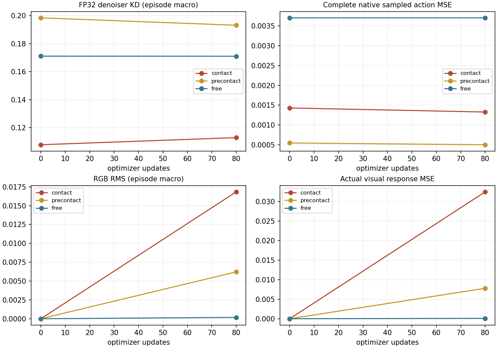

# Engineering evidence (2026-11-15)

Base HEAD: d92d1a6e4444901794a745e773267a47876b459c, branch V, initially clean.
Server:100.97.6.30, RTX4090 x4, existing PyTorch/CUDA environment unchanged.
GPU0 had an unrelated8.6GB allocation and was not touched.

The matched full checkpoint file SHA256 equals the provided historical source.
Static FP32 targets/Condition are newly built under a new cache key; old FP16
Token caches/old experiments remain unchanged. Existing decoded uint8 RGB is
reused only after exact TorchCodec pixel and saved-index audits.

| Same global batch8, KD forward/backward | Stable seconds | samples/s | peak allocated GB (decimal) | first call seconds |
|---|---:|---:|---:|---:|
| micro1, eager |1.744|4.59|2.86|1.76|
| micro2, eager |0.922|8.68|5.00|0.83|
| micro2, compile Renderer |0.768|10.42|4.60|52.29|
| micro2, compile visual |0.726|11.02|5.05|24.68|
| micro2, compile target DiT |0.919|8.71|5.03|12.20|
| micro2, compile student DiT |0.840|9.52|5.06|21.36|

These short3-step timing trials ran while another task-owned GPU built static
caches; they are measured local numbers, not promised speedups. They include the
same eight examples, fixed probes, same weights/objective. These rows time pure
KD computation and backward; formal-step profiles additionally include optimizer,
EMA, clipping, data/H2D and logging. Compile rows are separate options, not a
claimed combined speedup. Cold compiler cost is reported separately.

Visual compile gradient relative L2 versus eager0.001336, cosine0.999999225;
context relative L2 1.42e-6. Renderer compile gradient relative L2 0.047185,
cosine0.998905: Renderer defaults to eager. Target DiT compile gives negligible
stable speed benefit and stays eager; student DiT is also left eager by default.
Visual-only compile is enabled with an eager configuration fallback.

Precision audit (same fixed batch, micro2): Renderer BF16 versus FP32 gradient
cosine0.999594/relative L2 0.03113. Visual BF16 gradient cosine0.99639/relative
L2 0.08722, plus context errors ~0.0143 RMS; default frozen visual readout remains
FP32. DiT BF16 gradient cosine0.999963/relative L2 0.00993; it also remains FP32
for the conservative official precision policy. FP32 master weights/loss always.
This is a new configuration; it is not retroactively relabelling old BF16 runs.

Including loader startup/H2D and24 samples:0 workers7.96 samples/s;
2 spawn workers1.26 samples/s. The short sample includes startup and does not
establish long-run worker performance. Default0 workers is retained; shared
mmap data is already resident and avoids worker replication. No stream/large
worker pool was added on speculation.

Correctness JSON: alpha0 exact identity, input-RGB gradient norm1.3941, frozen
modules unchanged, strict next-update roundtrip bitwise identical, lightweight
export exact,4,495,375 deployment parameters. On the physical-zero probe,
alpha mean0.03941 and RGB RMS0.00032381; this is not conflated with alpha0.
The first strict-replay attempt exposed CUDA nondeterminism; deterministic
algorithms/cuDNN settings fixed it, and all failed replay calls remain counted.

DDP2 versus single GPU at global8/micro2: loss difference0, gradient relative
L2 2.4893e-6, cosine~1.0, maximum absolute4.6045e-6. No optimizer updates are
needed for this equivalence check. Four-GPU execution is supported by batch
arithmetic but was not claimed as measured while GPU0 was occupied.

Focused suite:30 passed (new direct-torque semantics plus existing staged frozen
DiT and denoiser tests). A broader historical selection exposed27 stale tests
requesting APIs already absent at base HEAD (`phase_prediction`,
`shared_condition_backbone`, and historical unconstrained/multicamera paths).
They are not reported as passes, nor repaired by reintroducing rejected
architectures. No old test files were deleted. Exact commands appear in the
implementation guide.

Before the full-data smoke:10 actual GPU optimizer calls charged:2 benchmark,
4 first replay,4 deterministic replay. The smoke and any further benchmark
updates share the total task cap100 and original exploration cap20000.

## Completed full-data80-step implementation smoke

Two idle GPUs on the four-card server completed80 updates with full1893-window
FP32 validation and native8-step action sampling at0 and80. All56 training
episodes remain available to the Mixed phase/episode queue;80 updates are only
640 sampled training exposures, not an entire training pass. No frozen parameter
changed. `latest.pt` (58MB), `initial.pt`, `best.pt` and `civi_rgb.pt` (18MB) are
preserved remotely under `data/diagnostics/civi_dit_minimal_v1/smoke80`.

Internal episode macro Contact denoiser KD:0.107724→0.112807 (worse4.72%).
Contact complete sampled action MSE:0.00143092→0.00132827 (better7.17%).
Precontact KD:0.198463→0.193181. Free KD:0.171078→0.171020, with nonzero actual
visual response after rendering. These measures disagree, so the smoke is
**not evidence that distillation is effective**. The selection criterion stays
internal Contact KD; no loss/architecture change was made to chase the result.
Retained episodes5/26 are reported separately and never select the model.

The early smoke summary's `rgb_rms` was a mean of sample RMS values. Per-sample
energy/MSE is preserved; formal reporting now computes sqrt(mean RGB energy)
within each episode, followed by an explicitly episode-macro RMS. `rgb_linf`
now reports the maximum rather than a mean of sample maxima. These reporting
corrections do not change gradients or model selection.

Real full-step DDP profile after compilation warmup: Renderer~108–125ms,
student FP32 visual~25–27ms, teacher DiT~29–59ms, student DiT~32–38ms,
backward~203–207ms, optimizer/EMA~8–12ms. Typical end-to-end global8 step
~0.55–0.70s, including~0.02–0.07s data wait (~11–15 global samples/s).
First step included~23.4s cold compilation; never average that into steady
throughput without disclosure. Per-rank allocated peak~2.57GB.

## User-authorized batch64/100-epoch formal run

After the bounded engineering smoke, the user explicitly requested100 epochs,
early stopping patience5, then global batch64 on dual24GB devices. A separate
formal budget (max27800 updates) is used; old exploration counts are not reset
or extended. Nominal epoch=ceil17740/64=278 updates. Mixed F16/P16/C32,
per-rank Renderer microbatch8, accumulation4. FP32 visual encode batch remains2
across all Renderer microbatch alternatives and reference evaluation.

Zero-update same64-example benchmark, visual encodeB2:

| Renderer microbatch | median full64 backward seconds (single GPU) | peak GB |
|---|---:|---:|
|2|7.923|2.77|
|4|4.583|4.76|
|8|2.953|8.69|

FP32-reduced KD losses agree to~3e-8 in this initial-state trial. No optimizer
updates were spent on batch sizing. These timings include a full64-example
backward on one card; they are not a claim of dual-card end-to-end speed.
The chosen microbatch8 leaves margin within24GB. No LR scaling is applied.

Batch64/micro8 two-GPU4-update smoke also completed. Its validation was explicitly
truncated to16 windows for integration checks and did not select a best model;
it is not substituted for the full1893-window0/80 evaluations. Engineering total
is94 real optimizer calls (2+4+4+80+4), below100. The batch64 DDP-versus-single
check used zero additional optimizer calls; exact gradient numbers are in
`ddp2_b64.json`. Focused suite after budget/epoch/chunking tests:33 passed.

The formal run was launched from immutable commit `469b9c9` on GPU2/3. It
completed its full1893-window step0 FP32 validation and entered real updates;
`formal_launch.json` records the first logged update and a later launch-time
snapshot. This file is not a completed-training result. Runtime curves are
`data/outputs/civi_dit_minimal_b64_s42_100epoch/learning_curves.png` on the server,
updated after each278-update validation. Current batch losses alone do not
establish internal-validation or sampled-action improvement.
